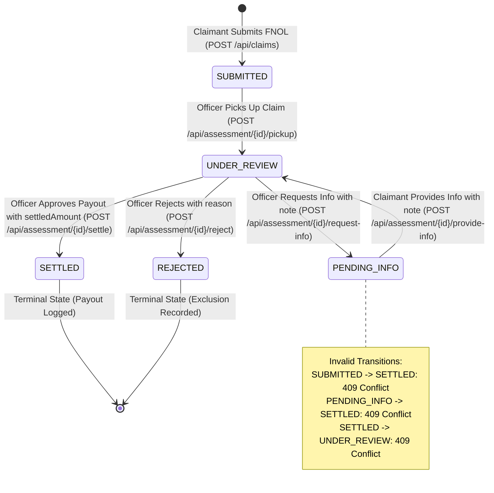

# Chubb APAC Claims Processing Platform

[](https://openjdk.org/projects/jdk/21/)
[](https://spring.io/projects/spring-boot)
[](https://redpanda.com/)
[](https://www.postgresql.org/)
[](https://angular.io/)
[](LICENSE)

Production-grade take-home technical assessment solution for the **Chubb APAC Engineering Young Graduate Program (Full-stack Developer)**.

---

## 1. System Overview

Chubb APAC processes motor and property insurance claims across 6 primary markets:
- 🇲🇾 **Malaysia (`MY`)**
- 🇸🇬 **Singapore (`SG`)**
- 🇹🇭 **Thailand (`TH`)**
- 🇭🇰 **Hong Kong (`HK`)**
- 🇦🇺 **Australia (`AU`)**
- 🇯🇵 **Japan (`JP`)**

The solution consists of:
1. **Spring Boot 3.3 (Java 21) Modular Monolith:** Packaged strictly by domain (`claims`, `assessment`, `exposure`, `notifications`, `common`), adhering to Domain-Driven Design (DDD) principles with CQRS read/write segregation.
2. **Event-Driven Messaging (Apache Kafka / Redpanda):** Guaranteed partitioned delivery (`claimId` message key) triggering asynchronous immutable audit logging, regional liability exposure projections, and simulated claimant alerts.
3. **PostgreSQL 16 Database:** Strict relational schema across `claims`, `claim_activities` (append-only audit log), and `market_exposure` (materialized read projection).
4. **Unified Angular 17 Frontend:** Single-page application equipped with an instant 1-click **Role Switcher** (`Claimant` vs `Claims Officer`), FNOL submission form, visual activity timeline, assessment triage workbench, and regional liability exposure cards.

---

## 2. High-Level Architecture & CQRS Topology

```mermaid
flowchart TD
    subgraph Frontend["Angular 17 Unified Frontend (Port 4200)"]
        RS["Role Switcher (1-Click: Claimant vs Officer)"]
        CD["Claimant Dashboard (FNOL Submission & Live Tracking)"]
        OW["Officer Workbench (Triage Queue & Assessment)"]
        EXP_UI["Regional Exposure Dashboard (CQRS Metrics)"]
        NOTIF_UI["Simulated Alert Drawer (Bell Indicator)"]
    end

    subgraph Backend["Spring Boot 3.3 Modular Monolith (Port 8080)"]
        Filter["UserContextFilter (Headers: X-User-Id, X-User-Role)"]
        
        subgraph Domains["Domain Modules"]
            ClaimSvc["claims: ClaimService & ClaimStateMachine"]
            AssessSvc["assessment: AssessmentService"]
            ExpoSvc["exposure: ExposureService"]
        end

        Producer["ClaimKafkaProducer (Key: claimId)"]
        
        subgraph Consumers["Kafka Consumers & Event Listeners"]
            AuditConsumer["ClaimActivityKafkaConsumer"]
            ExposureConsumer["MarketExposureKafkaConsumer"]
            NotifConsumer["ClaimantNotificationKafkaConsumer"]
        end
    end

    subgraph Infra["Infrastructure (Docker Compose)"]
        Kafka["Redpanda / Kafka Broker (Port 9092)"]
        Console["Redpanda Topic Console (Port 8088)"]
        Postgres[("PostgreSQL 16 Database (Port 5432)")]
    end

    Frontend -->|HTTP REST + Headers| Filter
    Filter --> Domains
    ClaimSvc -->|Save Claim & Activity| Postgres
    AssessSvc -->|State Transitions| Postgres
    Domains -->|Publish Domain Events| Producer
    Producer -->|Topic: chubb.claims.events| Kafka
    Kafka --> AuditConsumer
    Kafka --> ExposureConsumer
    Kafka --> NotifConsumer
    AuditConsumer -->|Append Immutable Audit Trail| Postgres
    ExposureConsumer -->|Update CQRS Read Projection| Postgres
    ExpoSvc -->|Read O(1) Projection| Postgres
    Kafka -.->|Topic Observability| Console
```

---

## 3. Strict Claim Lifecycle State Machine

The claim lifecycle is strictly governed by the domain state machine in `ClaimStateMachine.java`. Any transition violation raises an `InvalidStateTransitionException`, mapped globally to `HTTP 409 Conflict`.



---

## 4. Database Schema (PostgreSQL 16)

```
                 ┌──────────────────────────────────────────────┐
                 │                   claims                     │
                 ├──────────────────────────────────────────────┤
                 │ id (UUID, PK)                                │
                 │ reference_number (VARCHAR, UNIQUE)           │
                 │ market (VARCHAR: MY|SG|TH|HK|AU|JP)          │
                 │ claim_type (VARCHAR: MOTOR|PROPERTY)         │
                 │ policy_number (VARCHAR)                      │
                 │ claimant_name (VARCHAR)                      │
                 │ claimant_id (VARCHAR)                        │
                 │ incident_date (DATE)                         │
                 │ description (TEXT)                           │
                 │ estimated_amount (NUMERIC(14,2))             │
                 │ settled_amount (NUMERIC(14,2), NULLABLE)     │
                 │ status (VARCHAR: SUBMITTED..REJECTED)        │
                 │ assigned_officer_id (VARCHAR, NULLABLE)      │
                 │ created_at (TIMESTAMP)                       │
                 │ updated_at (TIMESTAMP)                       │
                 └──────────────────────┬───────────────────────┘
                                        │ 1
                                        │
                                        │ N
                 ┌──────────────────────▼───────────────────────┐
                 │              claim_activities                │
                 ├──────────────────────────────────────────────┤
                 │ id (UUID, PK)                                │
                 │ claim_id (UUID, FK -> claims.id)             │
                 │ actor_id (VARCHAR)                           │
                 │ actor_role (VARCHAR: CLAIMANT|OFFICER|SYSTEM)│
                 │ action_type (VARCHAR: SUBMITTED..REJECTED)   │
                 │ note (TEXT, NULLABLE)                        │
                 │ created_at (TIMESTAMP)                       │
                 └──────────────────────────────────────────────┘

                 ┌──────────────────────────────────────────────┐
                 │               market_exposure                │
                 ├──────────────────────────────────────────────┤
                 │ market (VARCHAR(10), PK)                     │
                 │ open_claim_count (BIGINT)                    │
                 │ total_estimated_exposure (NUMERIC(16,2))     │
                 │ total_settled_payout (NUMERIC(16,2))         │
                 │ last_updated_at (TIMESTAMP)                  │
                 └──────────────────────────────────────────────┘
```

---

## 5. Synchronous REST vs. Asynchronous Kafka Boundaries

| Operation | Protocol | Latency | Description |
|---|---|---|---|
| **FNOL Claim Submission** | `POST /api/claims` | Synchronous (< 50ms) | Validates input, generates `CHB-{MARKET}-{YEAR}-{SEQ}`, saves claim, emits `claim.submitted` event. |
| **Pickup Claim** | `POST /api/assessment/{id}/pickup` | Synchronous (< 30ms) | Assigns officer, transitions `SUBMITTED` -> `UNDER_REVIEW`, emits `claim.assigned`. |
| **Request Information** | `POST /api/assessment/{id}/request-info` | Synchronous (< 30ms) | Transitions `UNDER_REVIEW` -> `PENDING_INFO`, logs request note, emits `claim.info_requested`. |
| **Provide Information** | `POST /api/assessment/{id}/provide-info` | Synchronous (< 30ms) | Transitions `PENDING_INFO` -> `UNDER_REVIEW`, logs claimant response, emits `claim.info_provided`. |
| **Settle Claim** | `POST /api/assessment/{id}/settle` | Synchronous (< 30ms) | Authorizes payout amount, transitions `UNDER_REVIEW` -> `SETTLED`, emits `claim.decided`. |
| **Reject Claim** | `POST /api/assessment/{id}/reject` | Synchronous (< 30ms) | Records exclusion reason, transitions `UNDER_REVIEW` -> `REJECTED`, emits `claim.decided`. |
| **Audit Trail Consumer** | Kafka Consumer | Asynchronous | Listens to `chubb.claims.events` and guarantees immutable timeline persistence in `claim_activities`. |
| **Exposure Projection Updater** | Kafka Consumer | Asynchronous | Recalculates regional exposure totals in `market_exposure` in real time without blocking HTTP requests. |
| **Notification Consumer** | Kafka Consumer | Asynchronous | Simulates customer SMS/Email alerts and feeds notification drawer (`/api/notifications`). |
| **Query Market Exposure** | `GET /api/exposure` | Synchronous (< 5ms) | Performs instant $O(1)$ read from the materialized `market_exposure` projection. |

---

## 6. Lightweight Pragmatic RBAC (Evaluator Friendly)

To eliminate the operational burden of setting up external OAuth2/Keycloak servers for take-home assessment evaluation, authorization is handled via request headers:
- `X-User-Id`: Identifier of the acting user (e.g., `claimant-my-01`, `officer-sarah`).
- `X-User-Role`: `CLAIMANT` | `OFFICER` | `SYSTEM`.

The Angular frontend includes a **1-click Role Switcher** in the top navigation bar. Clicking `Claimant` or `Claims Officer` instantly updates the global `AuthService` state and injects corresponding headers via `authInterceptor`.

---

## 7. Quick Start Guide

### Option A: Standard Mode (Docker Compose + PostgreSQL + Redpanda)
Use this option when Docker is available on your machine:

1. **Start Infrastructure:**
   ```bash
   docker compose up -d
   ```
   - **PostgreSQL 16:** `localhost:5432` (`chubb_claims` / `postgres` / `postgres`)
   - **Redpanda (Kafka API):** `localhost:9092`
   - **Redpanda Topic Console:** 👉 **[http://localhost:8088](http://localhost:8088)**

2. **Start Backend:**
   ```bash
   cd backend
   ./mvnw spring-boot:run
   ```
   *(Windows: `.\mvnw.cmd spring-boot:run`)*

---

### Option B: Zero-Docker Local Mode (H2 + Embedded Kafka Broker)
Use this option to run and evaluate the full application **without Docker or VM platforms enabled**:

1. **Start Backend with `local` Profile:**
   ```bash
   cd backend
   .\mvnw.cmd spring-boot:run "-Dspring-boot.run.profiles=local"
   ```
   *(Linux/macOS: `./mvnw spring-boot:run -Dspring-boot.run.profiles=local`)*

   - **Embedded Kafka Broker:** Automatically boots an in-process Kafka broker with topic `chubb.claims.events` and controlled shutdown.
   - **H2 In-Memory Database:** Automatically configured with `ddl-auto: update` and pre-seeded evaluation demo data.
   - **H2 Web Console:** 👉 **[http://localhost:8080/h2-console](http://localhost:8080/h2-console)** (JDBC URL: `jdbc:h2:mem:chubb_claims`, User: `sa`, Password: empty)

---

### Step 2 (Common): Endpoints & Verification
Regardless of which profile is used:
- **Swagger UI:** 👉 **[http://localhost:8080/swagger-ui.html](http://localhost:8080/swagger-ui.html)**
- **Actuator Health:** 👉 **[http://localhost:8080/actuator/health](http://localhost:8080/actuator/health)**
- **Demo Seed Data:** Auto-seeds initial claims and regional market exposures upon boot.

### Step 3: Run Backend Tests
Run the comprehensive test suite (29 tests covering State Machine transitions, Kafka Producer, and full end-to-end integration):
```bash
cd backend
./mvnw test
```
*(Windows: `.\mvnw.cmd test`)*

### Step 4: Start Angular Frontend
```bash
cd frontend
npm install
npm start
```
Open your browser at:
👉 **[http://localhost:4200](http://localhost:4200)**

---

## 8. Guided Evaluation Walkthrough

To verify the end-to-end lifecycle in under 3 minutes using the Angular UI:

1. **Submit a Claim (as Claimant):**
   - In the top bar, ensure **Claimant** mode is active.
   - Click **➕ Submit New Claim (FNOL)**.
   - Choose Market `MY` (Malaysia), Claim Type `MOTOR`, Policy `POL-MY-2026-99`, Estimated Loss `MYR 4500.00`.
   - Click **Submit Claim**. Notice the new claim appears in the "My Tracked Claims" table with status `SUBMITTED`.
2. **Triage & Pick Up (as Claims Officer):**
   - Click **Claims Officer** in the top navigation bar (1-click role switch).
   - In the **Unassigned Queue** tab, observe the incoming claim.
   - Click **📥 Pick Up**. The claim immediately transitions to `UNDER_REVIEW` and moves to **My Review Queue**.
3. **Request Additional Info (as Officer):**
   - Under **My Review Queue**, click **❓ Request Info**.
   - Enter note: *"Please upload the official police accident report and vehicle repair estimate."*
   - Submit. The claim status updates to `PENDING_INFO`.
4. **Respond to Request (as Claimant):**
   - Switch back to **Claimant** mode.
   - Locate the claim and click **View & Respond**.
   - An alert appears: *"Action Required: Claims Officer Requested Additional Information"*.
   - Type response: *"Police report #PR-9921 attached along with workshop estimate."* and click **Submit Information to Officer**.
   - Notice the status immediately returns to `UNDER_REVIEW`.
5. **Authorize Settlement (as Officer):**
   - Switch back to **Claims Officer** mode.
   - Under **My Review Queue**, click **✅ Settle**.
   - Enter approved amount `4200.00` and note *"Approved after MYR 300 excess deduction"*.
   - Click **Authorize Settlement**. Status updates to `SETTLED`.
6. **Verify CQRS Read Projection:**
   - Click the **Regional Exposure (CQRS)** tab.
   - Notice the Malaysia (`MY`) card has updated: Open Claims reduced by 1, and Total Settled Payout incremented by `$4,200.00`.
7. **Inspect Kafka Messages in Redpanda Console:**
   - Open **[http://localhost:8088](http://localhost:8088)** in your browser.
   - Open topic `chubb.claims.events` to view the stream of domain events (`claim.submitted`, `claim.assigned`, `claim.info_requested`, `claim.info_provided`, `claim.decided`) with their corresponding UUID partition keys and payloads!

---

## 9. Implementation Phases & Git History

| Phase | Focus Area | Status | Commit |
|---|---|---|---|
| **Phase 1** | Workspace & infra initialization, Docker Compose (Postgres + Redpanda), Spring Boot modular monolith scaffolding | ✅ Complete | `3957d10` |
| **Phase 2** | Domain modeling (PostgreSQL entities), strict `ClaimStateMachine`, REST controllers, Global Error Handling (`409 Conflict`), RBAC | ✅ Complete | `1e5a008` |
| **Phase 3** | Kafka topic config, partition-keyed `ClaimKafkaProducer`, asynchronous consumers (Audit trail, Market Exposure CQRS, Notification simulator), integration tests | ✅ Complete | `8419a20` |
| **Phase 4** | Unified Angular 17 SPA, 1-click Role Switcher, Claimant Portal, Officer Workbench, Real-time Regional Exposure view | ✅ Complete | `de5631e` |
| **Phase 5** | End-to-end verification, architecture diagrams, documentation polish, and AI engineering journal | ✅ Complete | Current |

---

## 10. Architectural Trade-offs & Design Log

For a detailed diary of every design decision, edge-case mitigation, and architectural rationale recorded during development, please refer to:
👉 **[AI_JOURNAL.md](AI_JOURNAL.md)**
